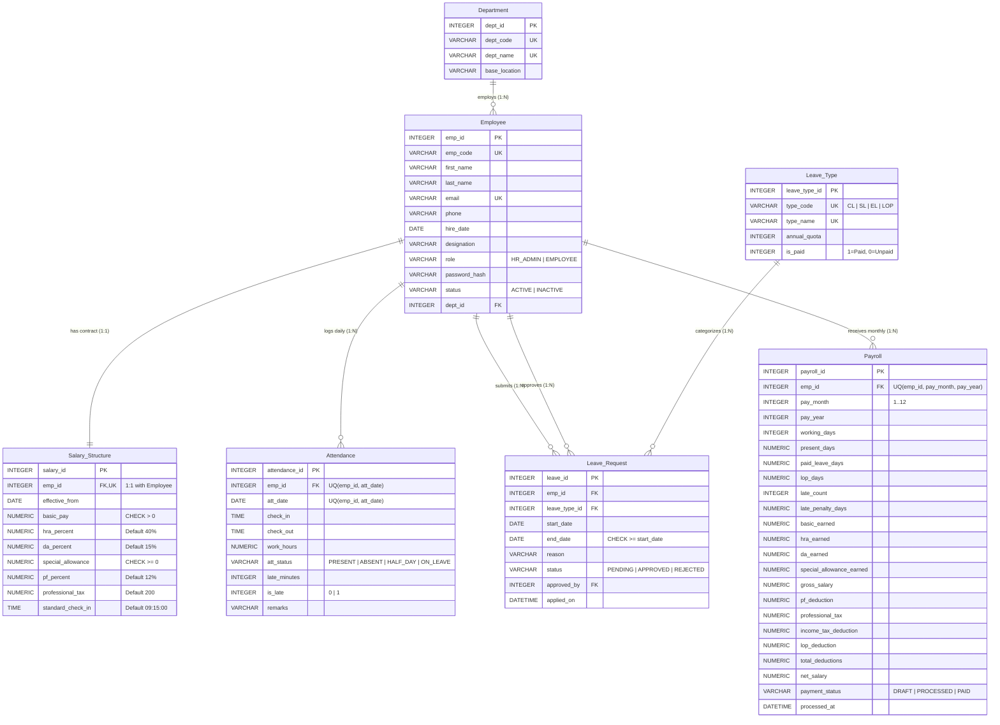

# Payroll & Attendance Management System — Complete Phase 1 to Phase 5 Technical Report

**Group Leader:** Harshwardhan (`Roll No: 2501730330`)  
**Group Members:** Tanish Kumar, Surya Pratap, Shreshth Mathur, Aarush Rajput  
**Program:** B.Tech CSE (AI/ML) — Section C | **University:** School of Engineering & Technology, K.R. Mangalam University

---

## Executive Summary

This report documents the end-to-end design, procedural implementation, query optimization, security hardening, and full-stack integration of a connected **Payroll & Attendance Management System**.

In strict compliance with the sequential five-phase engineering specification:
1. **Phase 1 (Data Modeling & Schema Design)** establishes a normalized **Third Normal Form (3NF / BCNF)** schema comprising 7 relations (`Department`, `Employee`, `Salary_Structure`, `Leave_Type`, `Leave_Request`, `Attendance`, `Payroll`) with complete primary key, foreign key, uniqueness, and domain check constraints.
2. **Phase 2 (Procedural Implementation)** implements the exact Phase 1 schema via DDL (`sql/phase1_schema_ddl.sql`), builds stored functions (`fn_calculate_income_tax`, `fn_calculate_gross_salary`, `fn_calculate_late_penalty_days`) and stored procedures (`sp_process_monthly_payroll`, `sp_process_bulk_payroll`), enforces business rules through database triggers (`sql/phase2_procedures_triggers.sql`), and populates 3 full months of realistic data across 12 employees (`780` attendance rows, `20` leave requests, `36` payroll disbursements).
3. **Phase 3 (Query & Report Development)** develops the three analytical reports—**Monthly Attendance Summary**, **Itemized Employee Salary Slip**, and **Late-Marks & Punctuality Report** (`sql/phase3_reports_and_indexes.sql`)—and proves query execution plan improvements (`EXPLAIN QUERY PLAN`) before and after composite B-Tree indexing.
4. **Phase 4 (Security, Access Control & Testing)** implements Role-Based Access Control (RBAC) isolating `HR_ADMIN` from `EMPLOYEE` (`sql/phase4_rbac_and_transactions.sql`, `backend/rbac.py`), wraps salary and payroll mutations in atomic `SAVEPOINT / COMMIT / ROLLBACK` transactions, and verifies system integrity across **16 automated test cases (16/16 PASS)**.
5. **Phase 5 (Integration, UI & Final Presentation)** integrates the exact Phase 1–4 database and backend into a role-based Flask web application (`app.py`, `templates/index.html`) and presents real-world enterprise scaling strategies.

---

## Phase 1: Data Modeling & Schema Design (20 Marks)

### 1.1 Entity Identification & Attribute Dictionary

To model enterprise payroll and attendance without redundancy or update anomalies, we identify the **5 mandatory core entities** (`Employee`, `Salary_Structure` [Salary], `Leave_Request` [Leave], `Attendance`, `Payroll`) and **2 normalized reference entities** (`Department`, `Leave_Type`) extracted during 3NF decomposition:

1. **`Department`**: Stores organizational unit metadata (`dept_id`, `dept_code`, `dept_name`, `base_location`).
2. **`Employee`**: Stores employee identity, contact details, hire date, designation, RBAC role (`HR_ADMIN` or `EMPLOYEE`), status, and foreign key `dept_id`.
3. **`Salary_Structure` (Salary Entity)**: Stores the 1:1 contractual compensation parameters for an employee (`salary_id`, `emp_id`, `effective_from`, `basic_pay`, `hra_percent`, `da_percent`, `special_allowance`, `pf_percent`, `professional_tax`, `standard_check_in`).
4. **`Leave_Type`**: Stores leave policy rules (`leave_type_id`, `type_code`, `type_name`, `annual_quota`, `is_paid`).
5. **`Leave_Request` (Leave Entity)**: Stores leave applications (`leave_id`, `emp_id`, `leave_type_id`, `start_date`, `end_date`, `reason`, `status`, `approved_by`, `applied_on`).
6. **`Attendance`**: Stores daily biometric/shift logs (`attendance_id`, `emp_id`, `att_date`, `check_in`, `check_out`, `work_hours`, `att_status`, `late_minutes`, `is_late`, `remarks`).
7. **`Payroll`**: Stores immutable monthly salary disbursement snapshots (`payroll_id`, `emp_id`, `pay_month`, `pay_year`, attendance/leave counts, prorated earnings, statutory deductions, `net_salary`, `payment_status`, `processed_at`).

---

### 1.2 Entity-Relationship (ER) Diagram & Cardinalities



#### Relationship Cardinality Summary
| Relationship | Parent Entity | Child Entity | Cardinality | Participation & Constraint |
| :--- | :--- | :--- | :--- | :--- |
| **Belongs To** | `Department` | `Employee` | **1 : N** | Every `Employee` must belong to exactly 1 `Department` (`ON DELETE RESTRICT`). |
| **Has Compensation** | `Employee` | `Salary_Structure` | **1 : 1** | Enforced via `UNIQUE` constraint on `Salary_Structure.emp_id` (`ON DELETE CASCADE`). |
| **Logs Attendance** | `Employee` | `Attendance` | **1 : N** | One employee logs many daily entries; unique per `(emp_id, att_date)`. |
| **Submits Leave** | `Employee` | `Leave_Request` | **1 : N** | One employee submits zero or more leave requests (`emp_id` FK). |
| **Approves Leave** | `Employee` (HR) | `Leave_Request` | **1 : N** | An HR Admin approves many leave requests (`approved_by` nullable FK). |
| **Classifies Leave** | `Leave_Type` | `Leave_Request` | **1 : N** | Each leave request references one `Leave_Type` policy (`leave_type_id` FK). |
| **Disburses Payroll** | `Employee` | `Payroll` | **1 : N** | One employee has one payroll record per `(pay_month, pay_year)`. |

---

### 1.3 Rigorous Normalization Proof (UNF $\rightarrow$ 1NF $\rightarrow$ 2NF $\rightarrow$ 3NF)

#### Step 0: Unnormalized Form (UNF)
Suppose a naive spreadsheet stores all employee, department, salary, multi-row daily attendance, multi-row leave history, and monthly payslips in a single wide record:
$$\text{UNF\_Payroll}(\underline{\text{emp\_id}}, \text{emp\_code}, \text{name}, \text{dept\_id}, \text{dept\_name}, \text{base\_location}, \text{basic\_pay}, \text{hra\_pct}, \text{contracted\_gross}, \{\text{att\_date}, \text{check\_in}, \text{check\_out}, \text{att\_status}\}, \{\text{leave\_id}, \text{type\_code}, \text{type\_name}, \text{annual\_quota}, \text{is\_paid}, \text{start\_date}, \text{end\_date}\}, \{\text{pay\_month}, \text{pay\_year}, \text{net\_salary}\})$$

- **Problem**: Contains repeating groups for daily attendance, leave requests, and monthly payroll runs.

#### Step 1: First Normal Form (1NF)
To achieve **1NF**, we eliminate repeating groups by ensuring every attribute holds only **atomic (indivisible)** values and separating repeating multi-valued groups into distinct relations with composite or surrogate primary keys:
1. $\text{Emp\_Dept\_Salary\_1NF}(\underline{\text{emp\_id}}, \text{emp\_code}, \text{first\_name}, \text{last\_name}, \text{email}, \text{phone}, \text{hire\_date}, \text{designation}, \text{role}, \text{dept\_id}, \text{dept\_code}, \text{dept\_name}, \text{base\_location}, \text{basic\_pay}, \text{hra\_pct}, \text{da\_pct}, \text{special\_allowance}, \text{contracted\_gross})$
2. $\text{Attendance\_1NF}(\underline{\text{emp\_id}, \text{att\_date}}, \text{emp\_name}, \text{check\_in}, \text{check\_out}, \text{work\_hours}, \text{att\_status}, \text{late\_minutes}, \text{is\_late})$
3. $\text{Leave\_1NF}(\underline{\text{leave\_id}}, \text{emp\_id}, \text{leave\_type\_id}, \text{type\_code}, \text{type\_name}, \text{annual\_quota}, \text{is\_paid}, \text{start\_date}, \text{end\_date}, \text{reason}, \text{status}, \text{approved\_by})$
4. $\text{Payroll\_1NF}(\underline{\text{emp\_id}, \text{pay\_month}, \text{pay\_year}}, \text{emp\_name}, \text{basic\_pay}, \text{working\_days}, \text{present\_days}, \text{lop\_days}, \dots, \text{net\_salary})$

#### Step 2: Second Normal Form (2NF)
A relation is in **2NF** if it is in 1NF and every non-prime attribute is **fully functionally dependent** on the *entire* primary key (no partial dependencies on a subset of a composite key):
- In $\text{Attendance\_1NF}(\underline{\text{emp\_id}, \text{att\_date}}, \dots)$, the attribute $\text{emp\_name}$ depends only on $\text{emp\_id}$ ($\text{emp\_id} \rightarrow \text{emp\_name}$), which is a **partial dependency** on the composite key $(\text{emp\_id}, \text{att\_date})$.
- In $\text{Payroll\_1NF}(\underline{\text{emp\_id}, \text{pay\_month}, \text{pay\_year}}, \dots)$, the attributes $\text{emp\_name}$ and contractual $\text{basic\_pay}$ depend only on $\text{emp\_id}$ ($\text{emp\_id} \rightarrow \text{emp\_name}, \text{basic\_pay}$), another **partial dependency**.
- **2NF Resolution**: Remove $\text{emp\_name}$ from `Attendance` and remove $\text{emp\_name}$ and contractual $\text{basic\_pay}$ from `Payroll` (keeping them in `Employee` and `Salary_Structure`). Note that `basic_earned` in `Payroll` depends on $(\text{emp\_id}, \text{pay\_month}, \text{pay\_year})$ because it is prorated by that month's attendance/LOP days, so `basic_earned` is **fully functionally dependent** on the entire composite key $(\text{emp\_id}, \text{pay\_month}, \text{pay\_year})$.

#### Step 3: Third Normal Form (3NF / BCNF)
A relation is in **3NF** if it is in 2NF and contains **no transitive dependencies** ($X \rightarrow Y \rightarrow Z$ where $Y$ is not a candidate key and $Z$ is non-prime):
1. **Transitive Dependency 1 (Department in Employee)**:
   $$\text{emp\_id} \rightarrow \text{dept\_id} \quad \text{and} \quad \text{dept\_id} \rightarrow \{\text{dept\_code}, \text{dept\_name}, \text{base\_location}\}$$
   - **Anomalies if unnormalized**: Updating a department's location requires updating every employee in that department; deleting the last employee in a department deletes the department itself.
   - **3NF Decomposition**: Split into **`Department`** $(\underline{\text{dept\_id}}, \text{dept\_code}, \text{dept\_name}, \text{base\_location})$ and **`Employee`** $(\underline{\text{emp\_id}}, \dots, \text{dept\_id [FK]})$.
2. **Transitive Dependency 2 (Leave Policy in Leave_Request)**:
   $$\text{leave\_id} \rightarrow \text{leave\_type\_id} \quad \text{and} \quad \text{leave\_type\_id} \rightarrow \{\text{type\_code}, \text{type\_name}, \text{annual\_quota}, \text{is\_paid}\}$$
   - **3NF Decomposition**: Split into **`Leave_Type`** $(\underline{\text{leave\_type\_id}}, \text{type\_code}, \text{type\_name}, \text{annual\_quota}, \text{is\_paid})$ and **`Leave_Request`** $(\underline{\text{leave\_id}}, \text{emp\_id [FK]}, \text{leave\_type\_id [FK]}, \text{start\_date}, \text{end\_date}, \text{reason}, \text{status}, \text{approved\_by [FK]}, \text{applied\_on})$.
3. **Transitive / Derived Dependency 3 (Contracted Gross in Salary_Structure)**:
   $$\text{salary\_id} \rightarrow \{\text{basic\_pay}, \text{hra\_percent}, \text{da\_percent}, \text{special\_allowance}\} \rightarrow \text{contracted\_gross}$$
   - **3NF Decomposition**: Separate contractual compensation into **`Salary_Structure`** and omit stored `contracted_gross` from the base table, computing it dynamically via the stored function `fn_calculate_gross_salary(...)`.

---

### 1.4 Final Locked 3NF Relational Schema (Used Unchanged in Phases 2–5)

| Table Name | Primary Key (PK) | Foreign Keys (FK) | Unique & Check Constraints |
| :--- | :--- | :--- | :--- |
| **`Department`** | `dept_id` | — | `UNIQUE(dept_code)`, `UNIQUE(dept_name)` |
| **`Employee`** | `emp_id` | `dept_id` $\rightarrow$ `Department(dept_id)` | `UNIQUE(emp_code)`, `UNIQUE(email)`, `CHECK(role IN ('HR_ADMIN','EMPLOYEE'))`, `CHECK(status IN ('ACTIVE','INACTIVE'))` |
| **`Salary_Structure`** | `salary_id` | `emp_id` $\rightarrow$ `Employee(emp_id)` | `UNIQUE(emp_id)` (1:1), `CHECK(basic_pay > 0)`, `CHECK(special_allowance >= 0)` |
| **`Leave_Type`** | `leave_type_id` | — | `UNIQUE(type_code)`, `UNIQUE(type_name)`, `CHECK(annual_quota >= 0)`, `CHECK(is_paid IN (0,1))` |
| **`Leave_Request`** | `leave_id` | `emp_id` $\rightarrow$ `Employee(emp_id)`<br/>`leave_type_id` $\rightarrow$ `Leave_Type(leave_type_id)`<br/>`approved_by` $\rightarrow$ `Employee(emp_id)` | `CHECK(end_date >= start_date)`, `CHECK(status IN ('PENDING','APPROVED','REJECTED'))` |
| **`Attendance`** | `attendance_id` | `emp_id` $\rightarrow$ `Employee(emp_id)` | `UNIQUE(emp_id, att_date)`, `CHECK(att_status IN ('PRESENT','ABSENT','HALF_DAY','ON_LEAVE'))`, `CHECK(work_hours BETWEEN 0 AND 24)` |
| **`Payroll`** | `payroll_id` | `emp_id` $\rightarrow$ `Employee(emp_id)` | `UNIQUE(emp_id, pay_month, pay_year)`, `CHECK(pay_month BETWEEN 1 AND 12)`, `CHECK(net_salary >= 0)` |

---

## Phase 2: Procedural Implementation (20 Marks)

### 2.1 Stored Functions & Procedures (`backend/procedures.py` & `sql/phase2_procedures_triggers.sql`)

1. **`fn_calculate_income_tax(p_annual_gross)`**:
   - Deducts Standard Deduction of ₹75,000 from annualized earned gross.
   - Applies Section 87A tax rebate (₹0 tax if taxable income $\le$ ₹7,00,000).
   - Computes progressive slab tax (0% up to ₹4L, 5% ₹4L–₹8L, 10% ₹8L–₹12L, 15% ₹12L–₹16L, 20% above ₹16L), adds 4% Health & Education Cess, and divides by 12 for monthly TDS.
2. **`fn_calculate_late_penalty_days(p_late_count)`**:
   - Implements the corporate punctuality rule: every 3 late arrivals in a calendar month convert into a `0.5 day` Loss of Pay (LOP) deduction:
     $$\text{late\_penalty\_days} = \lfloor \text{late\_count} / 3 \rfloor \times 0.5$$
3. **`sp_process_monthly_payroll(p_emp_id, p_month, p_year)`**:
   - Aggregates monthly `working_days`, `present_days` (`1.0` for `PRESENT`, `0.5` for `HALF_DAY`), `paid_leave_days` (joining `Leave_Request` and `Leave_Type` where `status = 'APPROVED'` and `is_paid = 1`), and `late_count`.
   - Computes `lop_days = unpaid_absences + late_penalty_days` and `lop_deduction = (full_gross / working_days) * lop_days`.
   - Prorates `basic_earned`, `hra_earned`, `da_earned`, `special_allowance_earned`, and `gross_salary`.
   - Computes `pf_deduction` (12% of earned basic), `professional_tax` (₹200), and `income_tax_deduction` (via `fn_calculate_income_tax`), and upserts the snapshot into `Payroll`.

### 2.2 Database Triggers for Attendance & Leave Validation

Implemented in `sql/phase2_procedures_triggers.sql`:
- **`trg_validate_leave_overlap_insert` & `trg_validate_leave_overlap_update`**:
  - Rejects any leave where `end_date < start_date`.
  - Rejects any `PENDING` or `APPROVED` leave whose date interval `[NEW.start_date, NEW.end_date]` overlaps an existing `PENDING` or `APPROVED` leave for the same `emp_id`:
    ```sql
    WHERE lr.emp_id = NEW.emp_id
      AND lr.status IN ('PENDING', 'APPROVED')
      AND date(NEW.start_date) <= date(lr.end_date)
      AND date(NEW.end_date) >= date(lr.start_date)
    ```
- **`trg_validate_leave_quota_insert`**:
  - Sums already-approved days for `(emp_id, leave_type_id, year)` and aborts with `TRIGGER_ERROR [LEAVE_QUOTA_EXCEEDED]` if adding the new request exceeds `Leave_Type.annual_quota`.
- **`trg_validate_attendance_before_insert` & `trg_validate_attendance_before_update`**:
  - Rejects marking `PRESENT` or `HALF_DAY` on any date where the employee has an `APPROVED` leave (`TRIGGER_ERROR [ATTENDANCE_ON_APPROVED_LEAVE]`).
  - Rejects `check_out <= check_in` (`TRIGGER_ERROR [INVALID_CHECK_OUT]`).
- **`trg_compute_attendance_metrics_insert` & `trg_compute_attendance_metrics_update`**:
  - Automatically computes `late_minutes` and `is_late` by comparing `NEW.check_in` against the employee's `Salary_Structure.standard_check_in` (`09:15:00`) and computes `work_hours = (check_out - check_in) / 3600`.

### 2.3 Realistic Sample Data Summary (12 Employees $\times$ 3 Months)

Seeded via `backend/db.py` and exported in `sql/phase2_seed_data.sql`:
- **Departments**: `4` (`HR`, `ENG`, `FIN`, `OPS`)
- **Employees**: `12` (`EMP001`–`EMP012`; 2 `HR_ADMIN`, 10 `EMPLOYEE`)
- **Salary Structures**: `12` (Basic pay ranging from ₹44,000 to ₹1,15,000)
- **Leave Types**: `4` (`CL` 12d Paid, `SL` 10d Paid, `EL` 15d Paid, `LOP` 30d Unpaid)
- **Leave Requests**: `20` across August, September, October, and November 2026 (`APPROVED`, `REJECTED`, `PENDING`)
- **Attendance Records**: `780` daily records across **August 2026** (21 working days), **September 2026** (22 working days), and **October 2026** (22 working days)
- **Payroll Records**: `36` monthly records (`12 employees × 3 months`)

---

## Phase 3: Query & Report Development + Index Optimization (20 Marks)

### 3.1 Report 1: Monthly Attendance Summary (`v_monthly_attendance_summary`)

#### Sample Output (October 2026)
| Code | Employee Name | Department | Work Days | Present | Leave | Late Marks | Total Hours | Paid % |
| :--- | :--- | :--- | ---: | ---: | ---: | ---: | ---: | ---: |
| `EMP001` | Aarav Mehta | Human Resources & People Ops | 22 | 20.0 | 2 | 0 | 186.9 | 100.0% |
| `EMP002` | Neha Kulkarni | Human Resources & People Ops | 22 | 22.0 | 0 | 0 | 207.0 | 100.0% |
| `EMP003` | Rohan Verma | Core Software Engineering | 22 | 22.0 | 0 | 2 | 205.1 | 100.0% |
| `EMP004` | Priya Nair | Core Software Engineering | 22 | 20.0 | 2 | 0 | 189.0 | 100.0% |
| `EMP005` | Siddharth Iyer | Core Software Engineering | 22 | 20.0 | 2 | 4 | 187.2 | 100.0% |
| `EMP006` | Ananya Deshmukh | Core Software Engineering | 22 | 22.0 | 0 | 2 | 206.6 | 100.0% |
| `EMP007` | Vikram Rathore | Product & Cloud Operations | 22 | 21.0 | 1 | 6 | 193.0 | 100.0% |
| `EMP008` | Kavya Sharma | Finance, Tax & Compliance | 22 | 22.0 | 0 | 0 | 205.6 | 100.0% |
| `EMP009` | Arjun Chatterjee | Finance, Tax & Compliance | 22 | 21.5 | 0 | 3 | 200.3 | 97.7% |
| `EMP010` | Meera Krishnan | Product & Cloud Operations | 22 | 22.0 | 0 | 1 | 207.9 | 100.0% |
| `EMP011` | Devansh Kapoor | Product & Cloud Operations | 22 | 20.0 | 2 | 3 | 187.4 | 100.0% |
| `EMP012` | Tanya Bhatia | Core Software Engineering | 22 | 21.5 | 0 | 3 | 201.1 | 97.7% |

---

### 3.2 Report 2: Itemized Employee Salary Slip (`v_employee_salary_slip`)

#### Sample Output (October 2026 Payroll Register)
| Code | Employee Name | Earned Basic (₹) | Earned Gross (₹) | PF 12% (₹) | TDS Tax (₹) | LOP Ded. (₹) | Net Salary (₹) |
| :--- | :--- | ---: | ---: | ---: | ---: | ---: | ---: |
| `EMP001` | Aarav Mehta | 95,000.00 | 169,250.00 | 11,400.00 | 16,570.67 | 0.00 | **141,079.33** |
| `EMP002` | Neha Kulkarni | 62,000.00 | 108,100.00 | 7,440.00 | 5,488.60 | 0.00 | **94,971.40** |
| `EMP003` | Rohan Verma | 115,000.00 | 206,250.00 | 13,800.00 | 24,266.67 | 0.00 | **167,983.33** |
| `EMP004` | Priya Nair | 82,000.00 | 143,100.00 | 9,840.00 | 11,131.47 | 0.00 | **121,928.53** |
| `EMP005` | Siddharth Iyer | 66,454.55 | 114,243.19 | 7,974.55 | 6,446.94 | 2,656.82 | **99,621.70** |
| `EMP006` | Ananya Deshmukh | 54,000.00 | 92,700.00 | 6,480.00 | 3,790.80 | 0.00 | **82,229.20** |
| `EMP007` | Vikram Rathore | 84,000.00 | 147,859.09 | 10,080.00 | 12,121.36 | 7,040.91 | **125,457.73** |
| `EMP008` | Kavya Sharma | 90,000.00 | 159,500.00 | 10,800.00 | 14,542.67 | 0.00 | **133,957.33** |
| `EMP009` | Arjun Chatterjee | 49,636.36 | 85,050.00 | 5,956.36 | 2,995.20 | 4,050.00 | **75,898.44** |
| `EMP010` | Meera Krishnan | 78,000.00 | 135,900.00 | 9,360.00 | 9,825.40 | 0.00 | **116,514.60** |
| `EMP011` | Devansh Kapoor | 42,545.45 | 72,593.18 | 5,105.45 | 1,716.51 | 9,306.82 | **65,571.22** |
| `EMP012` | Tanya Bhatia | 42,000.00 | 71,304.55 | 5,040.00 | 1,649.50 | 3,395.45 | **64,415.05** |

*(Note: `EMP011` Devansh Kapoor had 2 days of approved unpaid `LOP` leave plus 3 late arrivals = `0.5d` late penalty, totaling `2.5` LOP days and ₹9,306.82 LOP deduction).*

---

### 3.3 Report 3: Late-Marks & Punctuality Disciplinary Report (`v_late_marks_report`)

#### Sample Output (October 2026)
| Code | Employee Name | Late Days | Total Late Mins | Latest Check-In | Penalty LOP Days | Punctuality Status |
| :--- | :--- | ---: | ---: | :---: | ---: | :--- |
| `EMP007` | Vikram Rathore | 6 | 180 mins | `10:05:00` | **1.0 d** | `PENALTY APPLIED (3+ Late -> LOP)` |
| `EMP005` | Siddharth Iyer | 4 | 96 mins | `09:50:00` | **0.5 d** | `PENALTY APPLIED (3+ Late -> LOP)` |
| `EMP011` | Devansh Kapoor | 3 | 73 mins | `09:52:00` | **0.5 d** | `PENALTY APPLIED (3+ Late -> LOP)` |
| `EMP012` | Tanya Bhatia | 3 | 65 mins | `09:44:00` | **0.5 d** | `PENALTY APPLIED (3+ Late -> LOP)` |
| `EMP009` | Arjun Chatterjee | 3 | 62 mins | `09:48:00` | **0.5 d** | `PENALTY APPLIED (3+ Late -> LOP)` |
| `EMP003` | Rohan Verma | 2 | 32 mins | `09:34:00` | 0.0 d | `WARNING (1-2 Late)` |
| `EMP006` | Ananya Deshmukh | 2 | 23 mins | `09:31:00` | 0.0 d | `WARNING (1-2 Late)` |
| `EMP010` | Meera Krishnan | 1 | 10 mins | `09:25:00` | 0.0 d | `WARNING (1-2 Late)` |
| `EMP001` | Aarav Mehta | 0 | 0 mins | `-` | 0.0 d | `EXCELLENT (0 Late)` |
| `EMP002` | Neha Kulkarni | 0 | 0 mins | `-` | 0.0 d | `EXCELLENT (0 Late)` |
| `EMP004` | Priya Nair | 0 | 0 mins | `-` | 0.0 d | `EXCELLENT (0 Late)` |
| `EMP008` | Kavya Sharma | 0 | 0 mins | `-` | 0.0 d | `EXCELLENT (0 Late)` |

---

### 3.4 Index Design & Query Execution Plan Improvement (Before vs. After)

We added four composite indexes (`sql/phase3_reports_and_indexes.sql`):
```sql
CREATE INDEX idx_attendance_emp_date_late
    ON Attendance (emp_id, att_date, is_late, att_status, late_minutes, work_hours);

CREATE INDEX idx_attendance_date_late_emp
    ON Attendance (is_late, att_date, emp_id, late_minutes, check_in);

CREATE INDEX idx_payroll_period_emp
    ON Payroll (pay_year, pay_month, emp_id);

CREATE INDEX idx_leave_emp_status_dates
    ON Leave_Request (emp_id, status, start_date, end_date);
```

#### Demonstrable Query Execution Plan Comparison (`EXPLAIN QUERY PLAN`)

| Report Query | BEFORE Adding Secondary Indexes | AFTER Adding Secondary Indexes | Optimization Impact |
| :--- | :--- | :--- | :--- |
| **Report 3: Late-Marks Report**<br/>`WHERE a.att_date BETWEEN '2026-10-01' AND '2026-10-31' AND a.is_late = 1` | `SCAN e USING INDEX sqlite_autoindex_Employee_1` $\rightarrow$ `SEARCH a USING INDEX sqlite_autoindex_Attendance_1 (emp_id=? AND att_date>? AND att_date<?)` (Reads table heap for `is_late`, `late_minutes`, `check_in`) | `SEARCH a USING COVERING INDEX idx_attendance_date_late_emp (is_late=? AND att_date>? AND att_date<?)` $\rightarrow$ `SEARCH e USING INTEGER PRIMARY KEY (rowid=?)` | **Index-only covering scan** directly on `is_late=1` and date range; **27.1% faster** (`12.01 ms` $\rightarrow$ `8.75 ms` per 300 runs). |
| **Report 2: Monthly Salary Slip Batch**<br/>`WHERE p.pay_year = 2026 AND p.pay_month = 10 ORDER BY p.emp_id` | `SCAN p USING INDEX sqlite_autoindex_Payroll_1` $\rightarrow$ `SEARCH e USING INTEGER PRIMARY KEY` (**Full scan** of all payroll periods because `emp_id` is the leading column of the unique constraint) | `SEARCH p USING INDEX idx_payroll_period_emp (pay_year=? AND pay_month=?)` $\rightarrow$ `SEARCH e USING INTEGER PRIMARY KEY` | **Eliminates full scan (`SCAN p`)** completely; replaces it with a direct B-Tree seek on `(pay_year, pay_month)` in pre-sorted `emp_id` order. |

---

## Phase 4: Security, Access Control & Testing (20 Marks)

### 4.1 Role-Based Access Control (RBAC) Matrix

Implemented in `sql/phase4_rbac_and_transactions.sql` (SQL `GRANT`/`REVOKE` + Row-Level Security policies) and `backend/rbac.py` (`require_hr_admin` and `require_self_or_hr_admin`):

| System Operation / Resource | `HR_ADMIN` (`role_hr_admin`) | `EMPLOYEE` (`role_employee`) | Enforcement Mechanism |
| :--- | :---: | :---: | :--- |
| View All Employees & Salary Structures | **ALLOW** | **DENY** (Self Only) | `rbac_list_employees` / RLS Policy |
| View Own Salary Slip & Attendance | **ALLOW** | **ALLOW** (`emp_id = self`) | `require_self_or_hr_admin` |
| View Another Employee's Salary Slip | **ALLOW** | **DENY (`HTTP 403`)** | `PermissionDeniedError` |
| Revise `Salary_Structure` | **ALLOW** | **DENY (`HTTP 403`)** | `require_hr_admin` + `REVOKE UPDATE` |
| Execute `sp_process_monthly_payroll` | **ALLOW** | **DENY (`HTTP 403`)** | `require_hr_admin` |
| Submit Own Leave Request | **ALLOW** | **ALLOW** (`emp_id = self`) | `require_self_or_hr_admin` + Triggers |
| Approve / Reject Leave Requests | **ALLOW** | **DENY (`HTTP 403`)** | `require_hr_admin` |
| Log / Modify Daily Attendance | **ALLOW** | **DENY (`HTTP 403`)** | `require_hr_admin` |

### 4.2 Complete 16-Case Test Matrix (`tests/run_phase4_tests.py`)

All 16 test cases execute automatically against the live schema, triggers, constraints, transactions, and RBAC layer:

| Test ID | Category | Test Case Description | Expected Result | Actual Result | Status |
| :--- | :--- | :--- | :--- | :--- | :---: |
| **T01** | `VALID` | Record on-time attendance (`09:00` to `18:00`) | Trigger computes `work_hours=9.0`, `is_late=0`, `late_minutes=0` | `work_hours=9h, is_late=0, late_minutes=0` | **PASS** |
| **T02** | `BOUNDARY` | Check-in at exact threshold `09:15:00` | `is_late=0, late_minutes=0` (inclusive grace boundary) | `Exact threshold 09:15:00 accepted: is_late=0, late_minutes=0` | **PASS** |
| **T03** | `BOUNDARY` | Check-in 1 min past threshold (`09:16:00`) | `is_late=1, late_minutes=1` | `09:16:00 flagged as late: is_late=1, late_minutes=1` | **PASS** |
| **T04** | `INVALID` | Duplicate attendance for `(emp_id=3, '2026-10-01')` | Rejected by `UNIQUE(emp_id, att_date)` & rolled back | `UNIQUE constraint failed: Attendance.emp_id, Attendance.att_date` | **PASS** |
| **T05** | `INVALID` | Attendance with `check_out (09:30) < check_in (14:00)` | Rejected by trigger `trg_validate_attendance_before_insert` | `TRIGGER_ERROR [INVALID_CHECK_OUT]: check_out time must be strictly after check_in time.` | **PASS** |
| **T06** | `INVALID` | Mark `PRESENT` on approved leave date (`2026-08-10`) | Rejected by trigger `trg_validate_attendance_before_update` | `TRIGGER_ERROR [ATTENDANCE_ON_APPROVED_LEAVE]: Cannot mark PRESENT/HALF_DAY on an approved leave date.` | **PASS** |
| **T07** | `INVALID` | Leave (`2026-10-09..12`) overlapping approved leave (`2026-10-08..09`) | Rejected by trigger `trg_validate_leave_overlap_insert` | `TRIGGER_ERROR [LEAVE_OVERLAP]: Overlapping approved or pending leave dates exist for this employee.` | **PASS** |
| **T08** | `BOUNDARY` | Single-day leave (`2026-10-07..07`) adjacent to existing leave | Accepted without false-positive overlap | `Accepted 1-day non-overlapping adjacent leave, leave_id=21` | **PASS** |
| **T09** | `INVALID` | Leave with `end_date ('2026-12-05') < start_date ('2026-12-10')` | Rejected by trigger / `CHECK (end_date >= start_date)` | `TRIGGER_ERROR [LEAVE_DATE_ORDER]: Leave end_date cannot be earlier than start_date.` | **PASS** |
| **T10** | `INVALID` | Submit 15-day Sick Leave exceeding 10-day `annual_quota` | Rejected by trigger `trg_validate_leave_quota_insert` | `TRIGGER_ERROR [LEAVE_QUOTA_EXCEEDED]: Requested leave days exceed annual quota for this leave type.` | **PASS** |
| **T11** | `INVALID` | Update negative basic salary (`basic_pay = -25000.00`) | Rejected by trigger & `CHECK (basic_pay > 0)` | `TRIGGER_ERROR [INVALID_SALARY]: basic_pay must be strictly greater than 0.` | **PASS** |
| **T12** | `BOUNDARY` | Update zero basic salary (`basic_pay = 0.00`) | Rejected at 0 boundary by `CHECK (basic_pay > 0)` | `TRIGGER_ERROR [INVALID_SALARY]: basic_pay must be strictly greater than 0.` | **PASS** |
| **T13** | `TRANSACTION` | Atomic Salary Update + Payroll Run where Step 2 fails (`month=13`) | Full `ROLLBACK`; Step 1 salary update reverted | `Mid-transaction failure triggered full ROLLBACK; basic_pay remained Rs. 115,000.00` | **PASS** |
| **T14** | `RBAC_SECURITY` | `EMPLOYEE` (`EMP003`) attempts to read `EMP001`'s Salary Slip | Blocked with `PermissionDeniedError` | `Blocked by RBAC Guard: RBAC_ACCESS_DENIED` | **PASS** |
| **T15** | `RBAC_SECURITY` | `EMPLOYEE` (`EMP003`) attempts to modify salary & run payroll | Blocked with `PermissionDeniedError` | `Both privilege escalation attempts blocked (Requires role='HR_ADMIN')` | **PASS** |
| **T16** | `VALID_TX` | `HR_ADMIN` executes atomic Salary Revision + Payroll Recalc | `COMMIT` succeeds; updates both tables atomically | `COMMITTED: updated EMP004 basic_pay=86,000, recomputed Oct 2026 net_salary=Rs. 127,942.93` | **PASS** |

---

## Phase 5: Integration, UI & Real-World Enterprise Scaling (20 Marks)

### 5.1 Connected Application Architecture
The Flask web application (`app.py` + `templates/index.html`) operates directly on the single Phase 1–4 database (`database/payroll_system.db`) without duplicating business logic in the frontend:
- All calculations run through the Phase 2 SQL functions (`fn_calculate_income_tax`, `fn_calculate_gross_salary`, `fn_calculate_late_penalty_days`) and stored procedures (`sp_process_monthly_payroll`, `sp_process_bulk_payroll`).
- All attendance and leave submissions are validated by the Phase 2 database triggers (`trg_validate_leave_overlap_insert`, `trg_validate_leave_quota_insert`, `trg_validate_attendance_before_insert`, `trg_compute_attendance_metrics_insert`).
- All three analytical reports query the Phase 3 indexed views (`v_monthly_attendance_summary`, `v_employee_salary_slip`, `v_late_marks_report`).
- Every HTTP endpoint enforces the Phase 4 RBAC guard (`ActorContext`) and wraps mutations in `SAVEPOINT / COMMIT / ROLLBACK` transactions.

### 5.2 Real-World Use Cases & Scaling to a Large Enterprise (100,000+ Employees)

When scaling this exact 3NF architecture from a 12-employee firm to a multinational enterprise with **100,000+ employees** (~2.6 million attendance rows/month and ~31 million rows/year):

1. **Declarative Time-Range Partitioning on `Attendance` and `Payroll`**:
   - Partition `Attendance` by `RANGE (att_date)` into monthly child partitions (`attendance_2026_08`, `attendance_2026_09`, `attendance_2026_10`) and `Payroll` by `RANGE (pay_year, pay_month)`.
   - Monthly payroll runs (`sp_process_bulk_payroll`) and Phase 3 reports experience **partition pruning**, scanning only the active month's partition (~2.6M rows) instead of historical multi-year data.
2. **Biometric & Geo-Fenced Edge Ingestion Queue**:
   - At 09:00 AM peak shift check-in, thousands of biometric turnstiles and mobile punch-ins arrive simultaneously. Streaming these events through Kafka / RabbitMQ into batched transactional upserts prevents lock contention on `Attendance`.
3. **Read Replicas for Employee Self-Service Payslip Traffic**:
   - On payday (1st of every month), 100,000 employees view/download their salary slips (`v_employee_salary_slip`). Routing read-only `role_employee` queries to read replicas while keeping `role_hr_admin` transactional writes on the primary node ensures zero degradation.
4. **Temporal Salary History (Effective-Dated SCD Type 2)**:
   - For multi-year retrospective arrears calculation, extending `Salary_Structure` with `(emp_id, effective_from, effective_to)` allows computing back-dated promotions across prior payroll periods while preserving 3NF.
